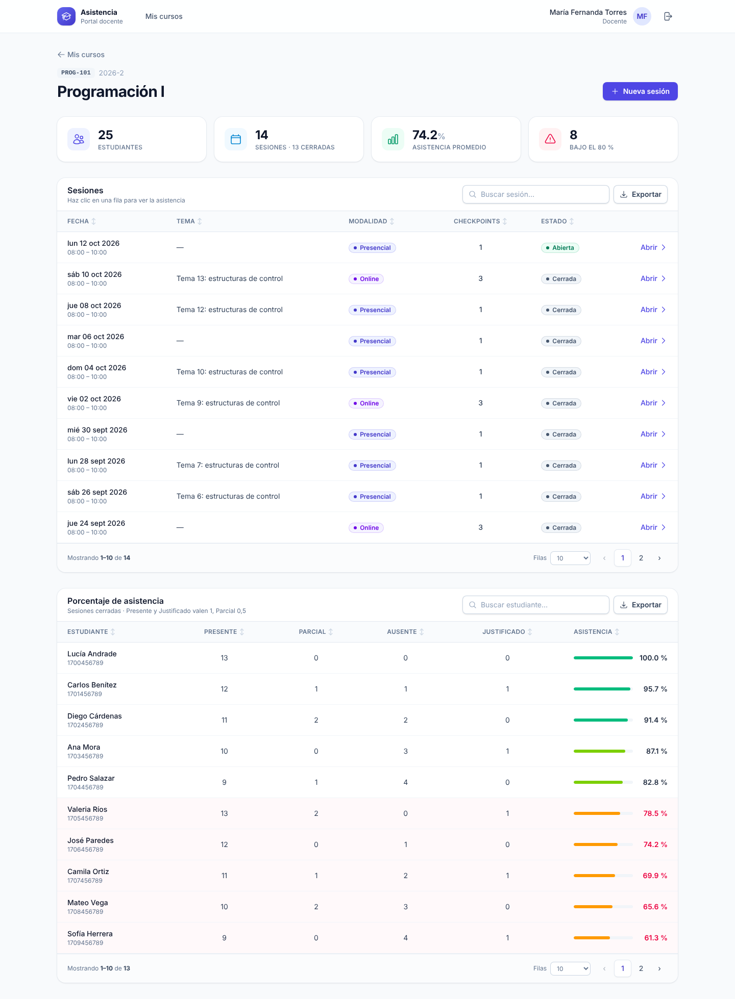
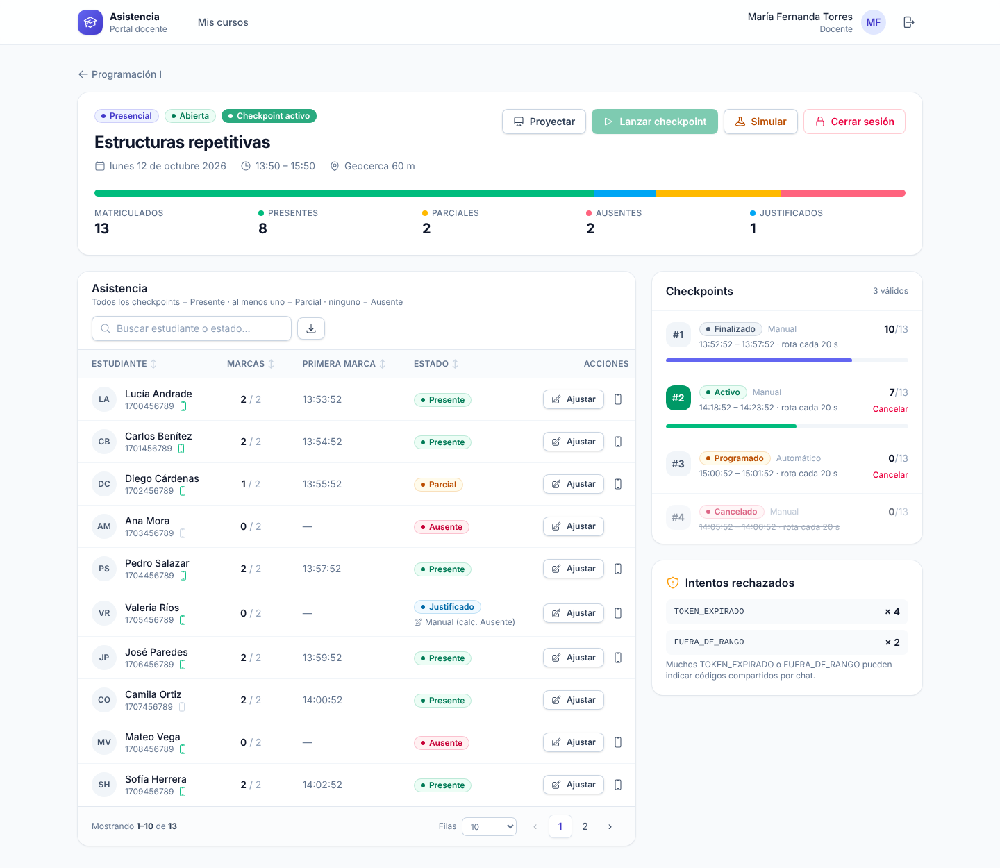
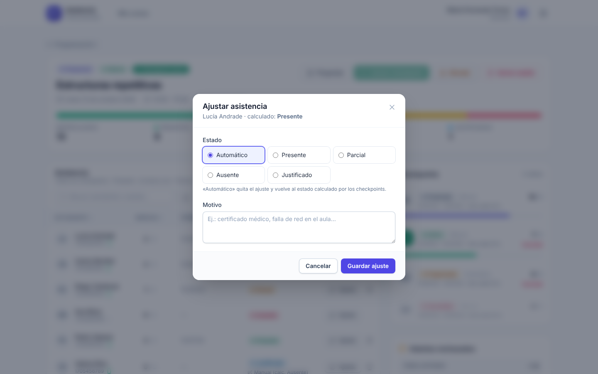

# Asistencia: class attendance with dynamic QR codes

[Leer en español](README.es.md)

Asistencia records student attendance with QR codes that keep changing. The teacher projects a QR code and a 6-digit code on the classroom screen, or shares them in a video call. Students mark themselves present from a mobile app.

The QR code and the 6-digit code change every 20 seconds. A photo sent to a friend expires before it can be used. For in-person classes, the app can also check that the student is inside the classroom using GPS.

## Features

**Teacher web portal**
- Create in-person or online class sessions.
- Launch attendance *checkpoints*, by hand or at random times during the class.
- A projection screen shows a large QR code, the 6-digit code, a countdown and how many students have checked in.
- See attendance live: Present, Partial, Absent or Excused.
- Override a student's status by hand, for example for a medical note or a network failure.
- See the attendance percentage per student, with an alert below 80%.
- Search, sort, page through and export every table to CSV.

**Student mobile app (Android and iOS)**
- Sign in with an email or national ID. Each account is linked to one phone.
- Scan the QR code, or type the 6-digit code when the class is online.
- See open checkpoints and the last 30 days of attendance history.

**Security**
- Each code is signed with HMAC-SHA256 using a per-checkpoint secret, like TOTP or Google Authenticator.
- One account per device and one device per account.
- Optional GPS geofence, with detection of fake (mock) locations.
- Rate limiting on sign-in and check-in. Every rejected attempt is logged for the teacher to review.

## Screenshots

**Course overview**: sessions and attendance percentage per student.



**Session detail**: live attendance, checkpoints and rejected attempts.



**Manual adjustment**: override the calculated status.



All names and IDs in the screenshots are demo data.

## Tech stack

| Part | Technology |
|---|---|
| Mobile app (`src/Asistencia.Maui`) | .NET MAUI 10 (Android and iOS), MVVM with CommunityToolkit.Mvvm, ZXing QR scanner |
| API and web portal (`src/Asistencia.Api`) | ASP.NET Core 10: REST API with JWT, plus an MVC portal with cookie sign-in |
| Data access | Dapper |
| Database (`database/`) | SQL Server 2019 or later |
| Portal UI | Tailwind CSS v4, plain JavaScript modules, Heroicons |
| Shared contracts (`src/Asistencia.Shared`) | DTOs and constants used by both the API and the app |
| Tests (`tests/Asistencia.Api.Tests`) | xUnit v3 |

```
 TEACHER (browser)                            STUDENT (MAUI app)
 Creates a session                            Signs in (links the phone)
 Launches a checkpoint ─┐                     ┌─ Scans the QR  ─┐
 Projects the screen    │ QR + 6-digit code   │  or types the   │
 (classroom or Zoom)    └── change every 20 s►│  code           │
                                              └─────────────────┘
                     ┌─────────────────────────────┐   POST /api/estudiante/marcar
 Sees attendance ◄───┤ API checks signature, time, │◄──────────────────────────────
 live and adjusts    │ enrollment, device and      │
                     │ geofence (in-person only)   │
                     └──────────────┬──────────────┘
                                    ▼
                               SQL Server
```

## Getting started

### Requirements
- .NET 10 SDK
- SQL Server 2019 or later (Express is fine)
- Visual Studio 2026, or Visual Studio 2022 17.14 or later, with the .NET MAUI workload (only needed for the mobile app)
- Node.js 20 or later, only if you change the portal styles

### 1. Create the database
Run the scripts in `database/` in SQL Server Management Studio, in this order:

1. `01_esquema.sql` creates the `AsistenciaDB` database and its tables.
2. Then pick one of these:
   - `02_datos_demo.sql` adds a small set of demo data: 1 teacher, 3 students and 1 course.
   - `03_datos_mock.sql` and `04_utilidades_prueba.sql` add 6 weeks of realistic history, sessions running today and a student simulator.

Every demo user has the password `Demo123*`:
- Teacher: `docente@demo.edu`
- Students: `carlos@demo.edu`, `lucia@demo.edu`, `diego@demo.edu`

Do not run the demo scripts on a production database.

### 2. Run the API and the teacher portal
1. Set the connection string `ConnectionStrings:AsistenciaDB` in `src/Asistencia.Api/appsettings.json`. The default uses Windows authentication on `localhost`.
2. The JWT signing key `Jwt:Clave` must be at least 32 characters long. `appsettings.Development.json` already has a key for local development. In production, set it with the environment variable `Jwt__Clave` or with .NET User Secrets. Never commit a real key.
3. Run the project:
   ```
   dotnet run --project src/Asistencia.Api
   ```
4. Open `http://localhost:5080` and sign in as `docente@demo.edu`.

The compiled CSS is already included, so you do not need Node.js to run the portal. If you change the styles, rebuild them:
```
cd src/Asistencia.Api
npm install
npm run css:build
```

### 3. Run the mobile app
1. Open `Asistencia.slnx` in Visual Studio and set `Asistencia.Maui` as the startup project.
2. Point the app at your API in `src/Asistencia.Maui/Constantes.cs`:
   - The Android emulator already uses `http://10.0.2.2:5080/`.
   - On a physical phone, use your PC's local IP address, for example `http://192.168.1.50:5080/`. Also add that IP to `Platforms/Android/Resources/xml/network_security_config.xml`, and open port 5080 in Windows Firewall.
3. Change `ApplicationId` in `Asistencia.Maui.csproj` to your own identifier.
4. Press F5 with an Android emulator or a phone selected.
5. Sign in as `lucia@demo.edu` or `diego@demo.edu`.

[docs/PRUEBA_APP_MOVIL.md](docs/PRUEBA_APP_MOVIL.md) has a step-by-step guide for phones, in Spanish.

### 4. Run the tests
```
dotnet test --project tests/Asistencia.Api.Tests/Asistencia.Api.Tests.csproj
```

[docs/GUIA_PRUEBAS.md](docs/GUIA_PRUEBAS.md) has an end-to-end test walkthrough, in Spanish.

## Roadmap
- Screens to manage courses, students and enrollments, which today are loaded with SQL
- Excel export
- Refresh tokens
- Push notifications when a checkpoint opens

## More details
[README.es.md](README.es.md), in Spanish, explains how the rotating token works, every check-in validation, the differences between in-person and online classes, the API endpoints and the configuration options.
